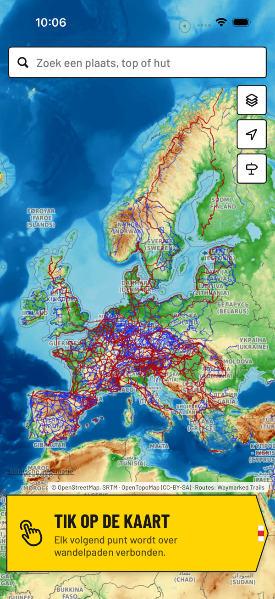
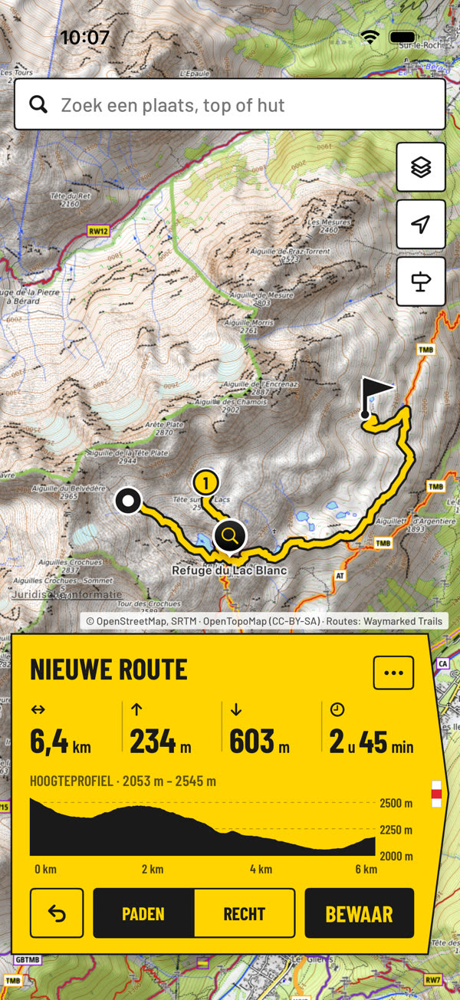
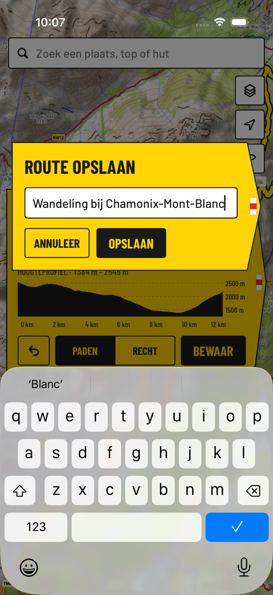
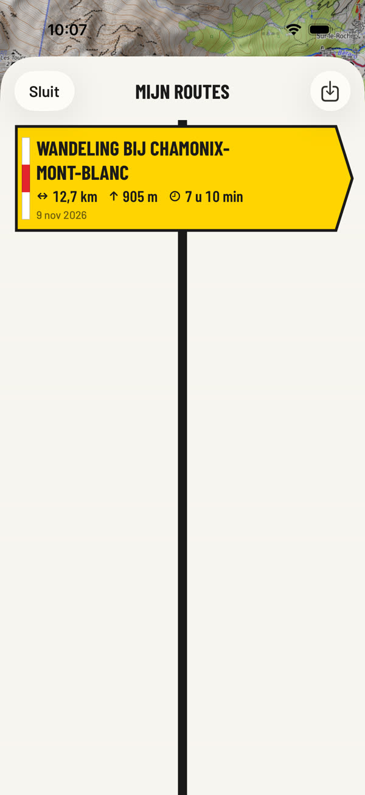

# Hike

iPhone-app om wandelingen te plannen, overal in Europa. Tik punten op de kaart; de app verbindt
ze over wandelpaden en laat afstand, hoogtemeters, wandeltijd en het hoogteprofiel zien.

Versie 2 heeft een eigen huisstijl, **Wegwijzer**: de gele wandelwegwijzer en de wit-rood-witte
markering. Zie [docs/HUISSTIJL.md](docs/HUISSTIJL.md).

| Start | Route | Bewaren | Mijn routes |
| --- | --- | --- | --- |
|  |  |  |  |

Hoe je de app gebruikt, in 46 seconden: [docs/hike-2-gebruik.mp4](docs/hike-2-gebruik.mp4).

## Wat de app kan

- **Plannen op de kaart** – tik om punten te zetten, houd een punt vast om het te verslepen,
  tik erop om het te kunnen verwijderen. Herstel (undo), route omkeren en "terug naar start" voor een rondje.
- **Routes over paden** – elk stuk wordt berekend over wandelpaden uit OpenStreetMap. Waar geen
  pad ligt kun je een stuk als rechte lijn tekenen.
- **Hoogteprofiel** – stijgen, dalen, hoogste en laagste punt; sleep over het profiel om de plek
  op de kaart te zien.
- **Wandeltijd** – volgens de regel van de alpiene wegwijzers (4 km/u, 300 m/u omhoog,
  500 m/u omlaag), met instelbaar tempo.
- **Kaarten** – topografisch (OpenTopoMap), OpenStreetMap, Apple Kaarten en satelliet, met de
  bewegwijzerde wandelroutes (GR-paden, E-paden, LAW's) als laag eroverheen.
- **Zoeken** – plaatsen, bergtoppen, meren, passen en berghutten in heel Europa.
- **Bewaren en delen** – routes blijven op het toestel staan; export en import als GPX
  (Komoot, Garmin, Wikiloc, OsmAnd, …).
- Eerder bekeken kaartdelen blijven in de cache en zijn ook zonder bereik te zien. Routes
  berekenen en zoeken vragen een internetverbinding.

## Op je iPhone zetten

Nodig: een Mac met Xcode 16 of nieuwer en een iPhone met iOS 17 of nieuwer.

1. Open `Hike.xcodeproj` in Xcode.
2. Kies bij het target **Hike → Signing & Capabilities** je eigen team (een gratis Apple-ID
   werkt) en pas zo nodig de bundle identifier aan.
3. Sluit je iPhone aan, kies hem als doel en druk op Run.

## Opbouw

| Map | Inhoud |
| --- | --- |
| `Hike/` | De app (SwiftUI + MapKit): kaart, planner, schermen. De huisstijl staat in `Hike/Brand/`. |
| `HikeCore/` | Swift-package zonder Apple-afhankelijkheden: routemodel, statistiek, GPX, opslag en de clients voor routeberekening en zoeken. |
| `HikeTests/` | Unit-tests van de planner (routes opbouwen, bewaren, GPX) met een nagebootste routeserver. |
| `HikeUITests/` | Rooktest die de echte app bedient: zoeken, route tikken, bewaren. |

De rooktest draait bij elke push ook in GitHub Actions; de schermafbeeldingen per stap en een
schermopname van de hele doorloop staan daarna als artefacten (`screenshots`, `walkthrough`) bij de run.

Alle tests draaien in Xcode met ⌘U. De kernlogica is ook los te testen, zonder Mac:

```bash
cd HikeCore && swift test
```

Met `HIKE_LIVE_TESTS=1 swift test --filter LiveServiceTests` draaien ook de tests die de echte
routeserver en zoekdienst aanroepen.

## Diensten

De app gebruikt openbare diensten zonder account of sleutel:

| Dienst | Waarvoor |
| --- | --- |
| [BRouter](https://brouter.de) | Routeberekening over wandelpaden, met hoogtes |
| [OpenTopoMap](https://opentopomap.org) en [OpenStreetMap](https://www.openstreetmap.org) | Kaarttegels |
| [Waymarked Trails](https://hiking.waymarkedtrails.org) | Laag met bewegwijzerde routes |
| [Photon](https://photon.komoot.io) | Zoeken op plaatsnaam |

Dit zijn gedeelde diensten die door vrijwilligers en donaties draaien; prima voor eigen gebruik,
maar niet bedoeld voor een app met veel gebruikers. Wie de app breed wil uitbrengen, zet eigen
servers neer of neemt een betaalde tegel- en routedienst. De adressen staan in
`Hike/Map/MapStyle.swift`, `HikeCore/Sources/HikeCore/Routing.swift` en `PlaceSearch.swift`.

Kaartgegevens © OpenStreetMap-bijdragers (ODbL).
