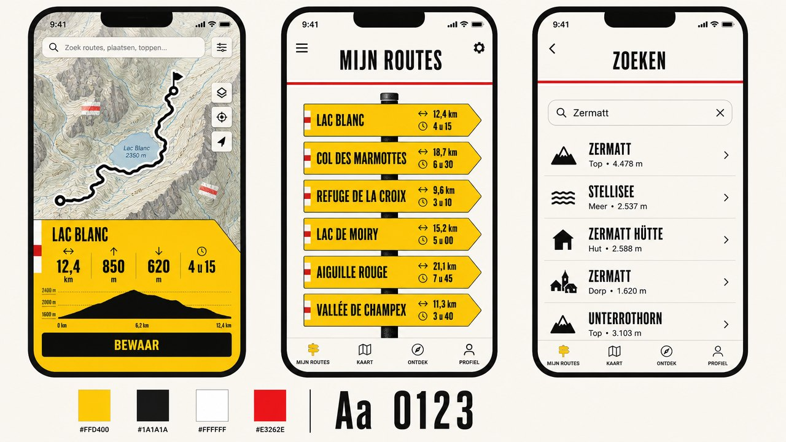
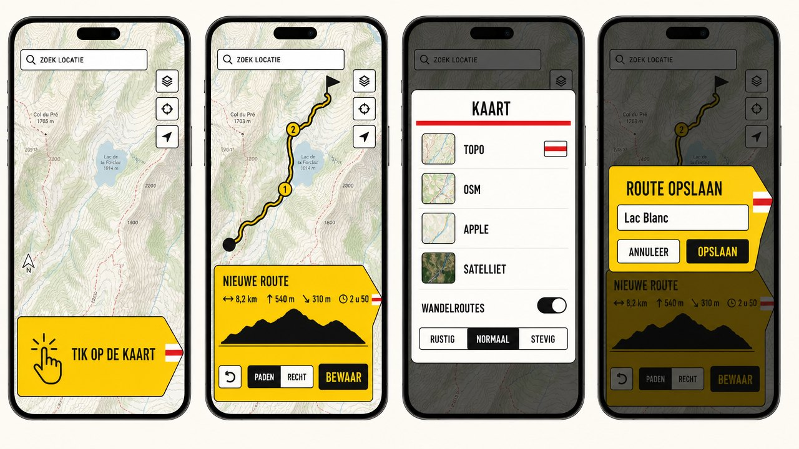
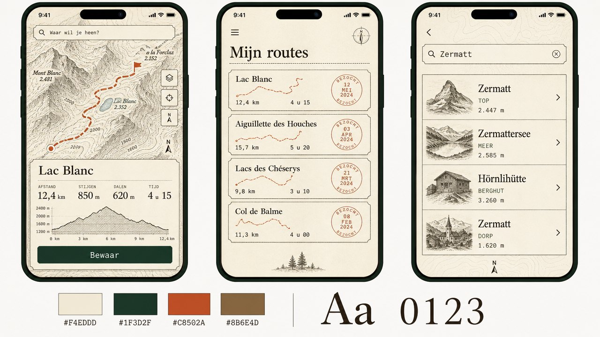
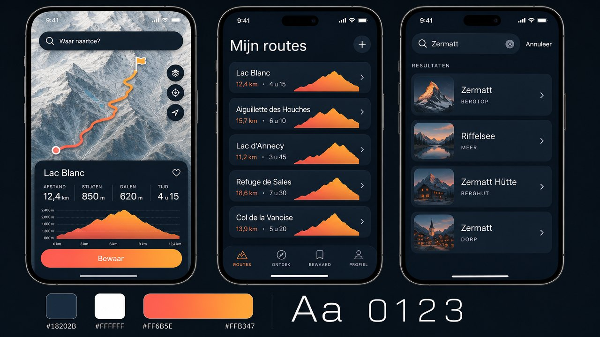

# Huisstijl: Wegwijzer

Hike 2 ziet eruit als wat je onderweg tegenkomt: de gele wandelwegwijzer en de wit-rood-witte
markering op rotsen en palen. Alles in de app is daarvan afgeleid.

## Kleur

| Naam | Waarde | Gebruik |
| --- | --- | --- |
| Wegwijzergeel | `#FFD400` | Borden: het routepaneel, bewaarde routes, de gekozen kaart, de routelijn |
| Inkt | `#1A1A1A` | Belettering op geel, omlijning, de hoofdknop |
| Markeringsrood | `#E3262E` | Alleen als accent: de streep onder een kop, waarschuwingen, de markering |
| Papier | wit / `#212121` in donkere modus | Achtergrond van vensters en witte knoppen |

Geel draagt altijd inktkleurige inhoud, ook in de donkere modus: een bord blijft een bord.

## Letter

- **Barlow Condensed Bold**, in kapitalen, voor koppen en cijfers. Barlow is getekend naar
  verkeers- en bewegwijzeringsborden.
- **Barlow Medium / SemiBold** voor lopende tekst en kleine labels.

Cijfers staan groot, de eenheid klein ernaast: `12,4 km`, `2 u 5 min`.

Barlow valt onder de SIL Open Font License; de licentie staat bij de lettertypebestanden in
`Hike/Brand/Fonts/`.

## Vorm

- **Het bord**: een rechthoek met één punt. Het routepaneel, elke bewaarde route en het
  opslaan-venster zijn borden. Bewaarde routes hangen onder elkaar aan een paal.
- **De markering**: wit-rood-wit, op de punt of het uiteinde van een bord, en als vinkje bij
  de gekozen kaart.
- **Witte knoppen** hebben een inktlijn van 1,5 pt en bijna rechte hoeken (4 pt), als gesneden
  plaatwerk. Geen kleurverloop, geen glas, hooguit een dunne schaduw onder een bord op de kaart.

## Kaart

- De route is een **gele lijn met inktrand**: de bordkleuren, en op elke kaartsoort zichtbaar.
  Een stuk in rechte lijn is gestreept; een stuk dat nog berekend wordt is een dunne inktstippellijn,
  een mislukt stuk een rode.
- **Start** is een inktring, **tussenpunten** zijn genummerde gele schijfjes, **het eind** is
  een vlag op het punt zelf.

## In de code

Alles staat in `Hike/Brand/`:

| Bestand | Inhoud |
| --- | --- |
| `Brand.swift` | Kleuren, maten, lettertypen en het registreren ervan |
| `Shapes.swift` | `SignpostShape` (het bord), `BlazeMark` (de markering), `SignHeading` (kop met rode streep) |
| `Controls.swift` | `InkButtonStyle`, `OutlineButtonStyle`, `SignSwitch`, `signTitle` |

De markers en de routelijn worden getekend in `Hike/Map/MapView.swift` (`MarkerArt`).

## Hoe het ontwerp tot stand kwam

De schermen zijn eerst als beeld ontworpen met de beeldgenerator van ElevenLabs, in drie
richtingen. Wegwijzer is gekozen omdat het de enige is die je niet met een andere wandel-app
verwart en die helemaal in code te maken is. De andere twee:

| Atlas | Alpenglow |
| --- | --- |
|  |  |
| Oude alpenclubkaart: papier, sparrengroen, gravures | Schemering: donker met een koraal-amber verloop |

Het app-icoon is op dezelfde manier ontworpen en daarna vierkant gemaakt.
